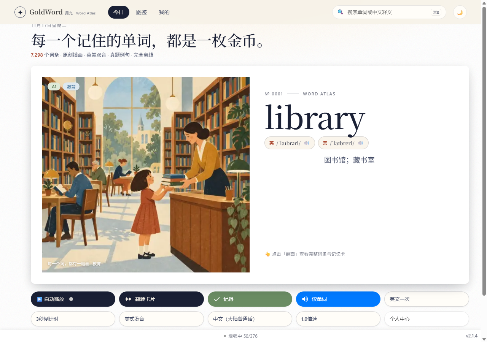
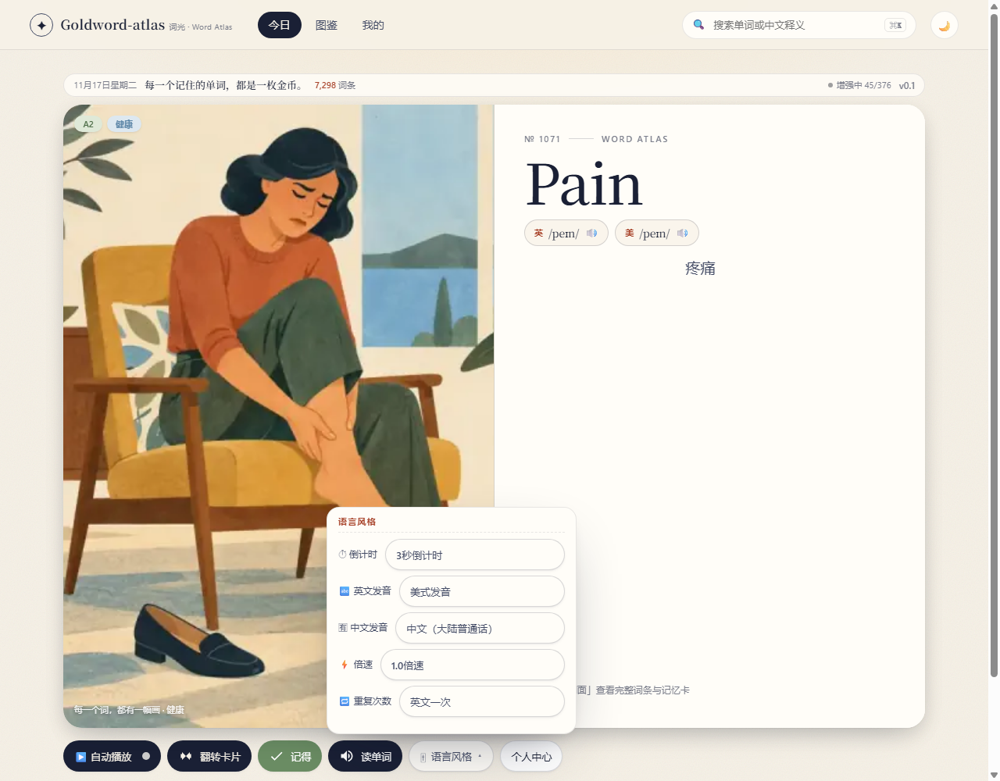
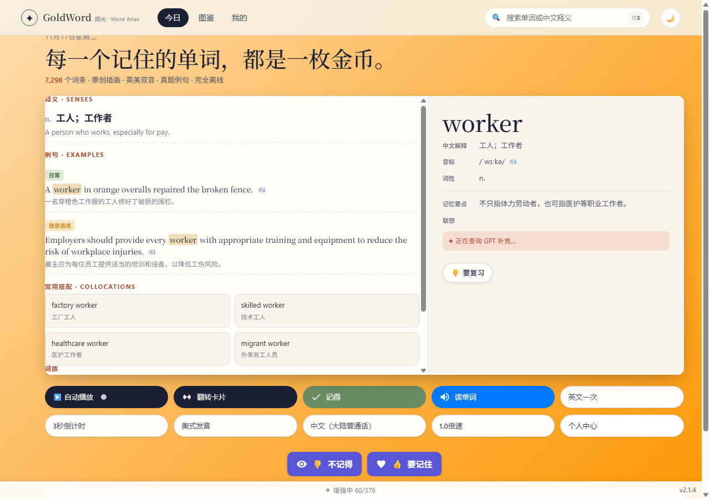
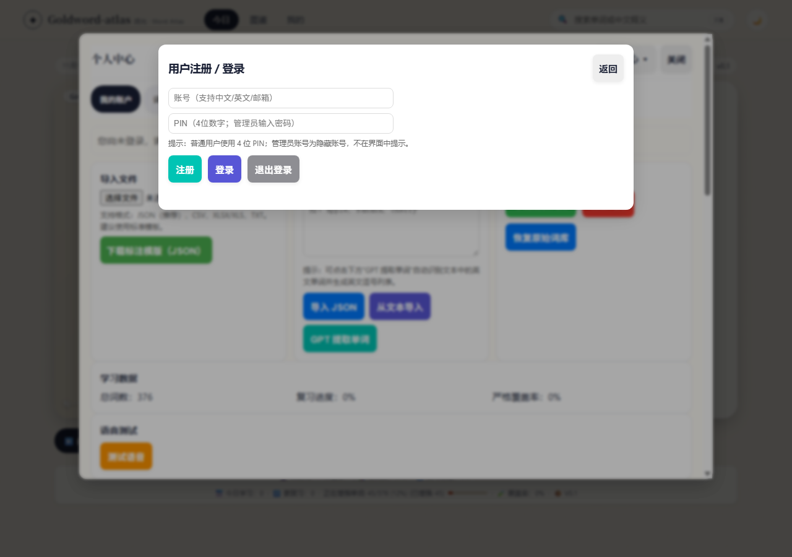

# Goldword-atlas 🪙📖

[](https://github.com/zixiang2008/Goldword-atla/releases)
[](#)
[](#)
[](docs/ATTRIBUTION.md)

> **每一个记住的单词，都是一枚金币。**

Goldword-atlas 是一个**离线优先**的英语单词学习应用：在原有 GoldWord 卡片翻页记忆流程的基础上，完整融入了 [Word Atlas（词光）](https://github.com/H1DDENADM1N/word-atlas) 的「纸墨」设计系统、7,298 词词条库、原创插画与英美双音离线录音。词库查不到时仍走本作原有的 GPT / OpenAI 兼容 API 增强兜底。

**English documentation:** [README.en.md](README.en.md) · **快速上手:** [docs/BUILD.md](docs/BUILD.md) · **免责声明:** [docs/DISCLAIMER.md](docs/DISCLAIMER.md)

---

## ⚠️ 免责声明（摘要）

本项目的界面设计、词库、插画与录音**大量参考并内置自开源项目 [Word Atlas（词光）](https://github.com/H1DDENADM1N/word-atlas)**（上游：[designfuchen/word-atlas](https://github.com/designfuchen/word-atlas)）。

- Word Atlas 的**源码与界面设计**采用 **MIT License**；其**词库文本、插画与录音**采用 [CC BY 4.0](https://creativecommons.org/licenses/by/4.0/)，署名为 **Word Atlas contributors（词光）**。
- 本项目为独立二次集成，与 Word Atlas 维护者、IELTS 考试主办方及任何语音提供方**无关联、无背书关系**。
- 内置内容由 AI 模型生成、自动校验，**未逐条人工审校，按现状提供，不担保准确性**。
- GPT 增强由用户自配 API、密钥仅存本地，输出由第三方模型生成，本项目不作担保。

**完整条款请务必阅读：[docs/DISCLAIMER.md](docs/DISCLAIMER.md) 与 [docs/ATTRIBUTION.md](docs/ATTRIBUTION.md)。**

---

## 界面预览

| 今日 · 卡片正面（左插画 + 右单词/音标） | 语言风格二级菜单 |
| :---: | :---: |
|  |  |

| 卡片背面（原左右两栏 + 词库全字段） | 个人中心（修复遮挡后） |
| :---: | :---: |
|  |  |

## 功能特性

### 学习主体（GoldWord 原有能力）
- **卡片翻页记忆**：自动播放、倒计时、翻转、记得/不记得、记忆循环与复习队列。
- **多种发音模式**：英式/美式、中文语音、倍速、重复次数、顺序组合，收在「语言风格」二级菜单中。
- **GPT 兜底**：词库外的单词调用 OpenAI 兼容 API 补齐释义与记忆提示；密钥只在设备本地填写，不写入源码或 APK。
- **本地数据**：学习进度、用户、词表全部保存在设备本地，无需账号即可离线使用。

### 词库与视觉（来自 Word Atlas）
- **纸墨主题**：米黄纸底、衬线标题、颗粒质感、赭石/青蓝配色，深浅主题可切换。
- **7,298 词条**：分级 A1–C2、19 个话题，原创插画 7,298 幅、缩略图 7,298 幅。
- **22,905 段离线录音**：英音/美音单词发音、日常例句、雅思例句，音标旁喇叭直接播放。
- **图鉴画廊**：按难度与话题筛选、中英文搜索、词条详情弹层、一键加入学习卡；插画优先的大图卡片网格。
- **环境声 / 背景音乐**：顶栏 ♪ 入口提供星空音乐、雨天图书馆、清晨海岸、林间早晨、夜晚壁炉、远航船舱、安静咖啡馆 7 种环境声，可调音量；朗读单词时自动压低（duck），关闭选择即静音。
- **完整映射**：卡片背面融入多义项释义、英文释义、例句与译文、搭配、词族、近/反义词、记忆提示、难度与话题标签。

## 快速开始

### 1. 获取源码

```bash
git clone https://github.com/zixiang2008/Goldword-atla.git
cd Goldword-atla
npm install
```

### 2. 离线资源（已随仓库提供）

**7,298 插画 + 22,905 段录音 + 24 段环境声/提示音已全部提交进本仓库**，克隆后无需额外下载即可构建与离线使用。

`scripts/fetch-atlas-assets.sh` 仍保留，用于从 [Word Atlas 官方仓库](https://github.com/H1DDENADM1N/word-atlas) 重新拉取/更新上游资源；它会覆盖 `www/atlas/`、`www/brand/`，并校验文件数量。

> 详细步骤、目录映射与离线构建说明见 **[docs/BUILD.md](docs/BUILD.md)**。

### 3. 运行 / 构建

```bash
# 浏览器预览（静态服务器；不要用 file:// 直接打开）
npx serve www

# Android
npx cap sync android
cd android && ./gradlew assembleRelease
```

完整签名与安装流程见 [docs/BUILD.md](docs/BUILD.md)。现成 APK 见 [Releases](https://github.com/zixiang2008/Goldword-atla/releases)。

## 目录结构

```
.
├── www/                      # Capacitor Web 根目录
│   ├── index.html            # 主页 / 卡片 / 图鉴 / 设置面板
│   ├── app.js, ui.js, db.js  # 原有 GoldWord 核心逻辑与卡片翻页
│   ├── atlas.css             # word-atlas「纸墨」设计系统（唯一视觉令牌来源）
│   ├── wordatlas.js          # 融合层：数据映射 / 离线音频 / 图鉴 / 语言风格菜单
│   ├── ambience.js           # 环境声（Web Audio 无缝循环 + 朗读 ducking）
│   ├── ATTRIBUTION.md        # 内容署名
│   ├── atlas/                # 词库 / 插画 / 缩略图 / 录音（随仓库提供）
│   ├── brand/                # 参考项目品牌图
│   └── sfx/                  # 环境声与提示音（随仓库提供）
├── scripts/
│   ├── fetch-atlas-assets.sh # 从 upstream 重新拉取资源（可选）
│   └── fetch-atlas-assets.cmd# Windows 包装器
├── android/                  # Capacitor Android 工程
├── docs/
│   ├── DESIGN-SYSTEM.md      # 设计与代码规范（最高准则）
│   ├── DISCLAIMER.md         # 完整免责声明（参照 upstream 条款）
│   ├── ATTRIBUTION.md        # 完整署名与修改说明
│   ├── BUILD.md              # 构建 / 签名 / 安装 / 排错
│   └── WORDATLAS-INTEGRATION.md # 融合设计说明
└── README.md / README.en.md
```

## 系统要求

| 项目 | 要求 |
| :--- | :--- |
| Node.js | 18+（推荐 20 LTS） |
| JDK | 21（Gradle 8.13 / AGP 8.13） |
| Android SDK | API 36（compileSdk / targetSdk） |
| 设备 | Android 8.0+，平板优先；首次安装建议预留 2 GB 空间 |
| 磁盘 | 仓库约 650 MB（含词库资源），构建再预留 2 GB |

## 参考来源与致谢

| 内容 | 来源 | 许可 |
| :--- | :--- | :--- |
| 界面设计、词库、插画、录音 | [Word Atlas（词光）](https://github.com/H1DDENADM1N/word-atlas) | 代码 MIT / 内容 [CC BY 4.0](https://creativecommons.org/licenses/by/4.0/) |
| 上游原始项目 | [designfuchen/word-atlas](https://github.com/designfuchen/word-atlas) | 同上 |
| Fraunces 字体 | Word Atlas 内置 | SIL Open Font License 1.1 |
| 卡片记忆、GPT 增强、账号体系 | GoldWord 原项目 | 本项目原有代码 |

感谢 Word Atlas contributors（词光）开源词典、插画与录音，使本项目的完全离线词卡体验成为可能。

## 许可与免责

除明确引用的第三方内容外，本项目代码按仓库现状提供。第三方内容的许可、署名、AI 生成内容说明、录音授权范围、非官方 IELTS 声明等**完整条款见 [docs/DISCLAIMER.md](docs/DISCLAIMER.md)**；使用本项目即表示你已阅读并同意其中内容。
